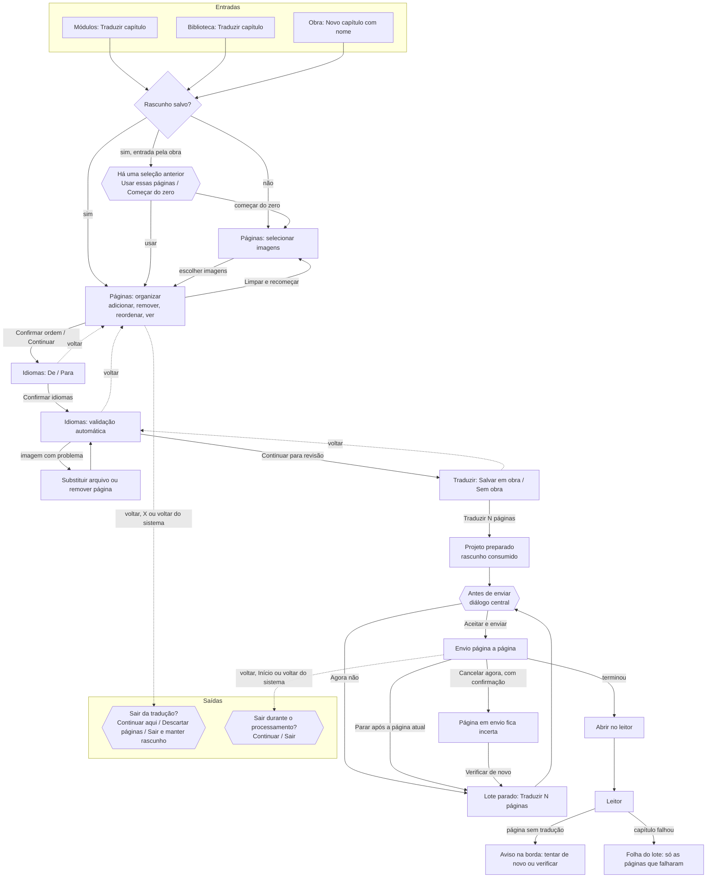
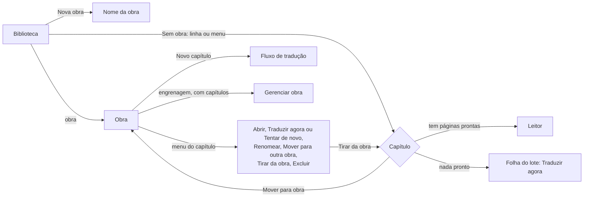

# Fluxo de tradução e de capítulos (mapa de 2026-11-10)

Documento informativo. Descreve como o fluxo funciona no código depois dos ajustes de 2026-11-10 e lista os defeitos
que motivaram cada ajuste. As regras normativas continuam nas specs 012–021, 045, 055, 056, 060 e 063.

## Mapa

### Biblioteca, obra e capítulos

## Defeitos encontrados e o que mudou

| #   | Problema                                                                                                 | Causa                                                                       | Correção                                                                                                                                           |
| --- | -------------------------------------------------------------------------------------------------------- | --------------------------------------------------------------------------- | -------------------------------------------------------------------------------------------------------------------------------------------------- |
| D1  | Não dava para desistir da tradução: o rascunho voltava sempre                                            | Rascunho salvo sozinho, sem ação de descartar                               | "Cancelar tradução" (X) e diálogo "Sair da tradução?" com **Descartar páginas** ou **Sair e manter rascunho**; `discard()` apaga linhas e arquivos |
| D2  | Ao voltar para Páginas, o botão "Ordem confirmada" ficava desabilitado e não havia como seguir em frente | O botão só confirmava                                                       | Com a ordem confirmada, o botão vira **Continuar**; o texto deixou de apontar para "abaixo"                                                        |
| D3  | Voltar do Android e gesto do iOS pulavam as etapas e a confirmação                                       | Sem `beforeRemove`                                                          | `useLeaveGuard`: o voltar do sistema faz o mesmo que o voltar da tela; o gesto fica desligado enquanto há rascunho ou envio                        |
| D4  | Sair do fluxo empilhava telas e não voltava à obra de origem                                             | `router.replace` fixo                                                       | Volta para a origem (`navigateBackOrReplace`), Início continua indo para Módulos                                                                   |
| D5  | Não havia cancelamento durante o envio                                                                   | Só existia "Parar", que na prática abortava                                 | **Cancelar agora** com confirmação, dizendo que a página em envio fica incerta                                                                     |
| D6  | "Parar após a página atual" interrompia a página atual                                                   | Um só sinal de abort para tudo                                              | Sinal de parada separado, checado entre páginas; a página em envio termina                                                                         |
| D7  | Abrir a central de controle no iOS parava o envio                                                        | Parava em qualquer estado diferente de `active`                             | Só para (com calma) quando o app vai para `background`                                                                                             |
| D8  | Páginas incertas ficavam presas                                                                          | Nenhuma ação para consultar de novo                                         | **Verificar de novo** no lote e no aviso do leitor (só consulta o recibo; nada é reenviado)                                                        |
| D9  | Capítulo nunca enviado não tinha como ser traduzido depois                                               | Menu só oferecia "Tentar de novo" com falhas; linha "Sem obra" desabilitada | **Traduzir agora** no menu da obra e da biblioteca; a linha sem páginas prontas abre o lote                                                        |
| D10 | Destino "Salvar em" travado depois de preparar                                                           | `locked` fixo                                                               | Destino pode mudar até o vínculo acontecer ou o envio começar                                                                                      |
| D11 | "Novo capítulo" usava calado as páginas de um rascunho antigo                                            | Rascunho restaurado sem aviso                                               | Diálogo "Há uma seleção anterior": usar essas páginas ou começar do zero                                                                           |
| D12 | Fechar a folha de retry durante o envio interrompia sem aviso                                            | A folha desmontava o lote                                                   | `BatchRetrySheet` pede confirmação enquanto envia                                                                                                  |
| D13 | Dois toques em "Aceitar" podiam iniciar dois envios                                                      | Guarda só no estado do React                                                | Trava síncrona no lote e botão do diálogo desabilitado após aceitar                                                                                |
| D14 | Validação só deixava substituir; o CTA "Corrigir N imagens" só filtrava                                  | Ação ausente; texto enganoso                                                | **Remover página** no detalhe; CTA "Ver N imagens com problema"                                                                                    |
| D15 | Voltar de Páginas mostrava um card intermediário com "Substituir seleção", que trocava tudo sem aviso    | Etapa extra                                                                 | Páginas é a primeira tela quando já há imagens; recomeçar é explícito e confirmado                                                                 |
| D16 | Voltar do leitor mostrava estados antigos do lote                                                        | Lote só recarregava após enviar                                             | Recarrega ao voltar o foco para a tela                                                                                                             |
| D17 | Capítulo de uma obra não podia mudar de obra nem sair dela                                               | Só existia excluir                                                          | **Mover para outra obra** e **Tirar da obra**, em uma transação, sem apagar a tradução                                                             |

## Padrões aplicados

- **Confirmações e consentimento**: diálogo central (`CenterDialog`, `ConfirmDialog`), cartão de até 400 pt, ícone no
  tom da ação, ações lado a lado (cancelar à esquerda) e empilhadas quando não cabem.
- **Resultado de uma ação**: notificação temporária (`showToast`) no topo, sem empurrar a tela; some em 3,5 s (erro em
  5 s). Estados persistentes (indisponível, envio em andamento) continuam como `StatusMessage` na tela.
- **Teclado**: folhas e diálogos sobem acima do teclado (`useKeyboardOverlap`), o corpo rola e a ação fica visível.

## Pendências conhecidas

- O cancelamento imediato interrompe o envio no aparelho; ele não pede ao gateway para cancelar a tentativa remota. A
  página fica incerta e pode ser verificada de novo.
- Os avisos de página no leitor e a folha de lote usam instâncias separadas do lote; a trava evita início duplo em cada
  uma, e a segunda tentativa concorrente é recusada pelo serviço.
